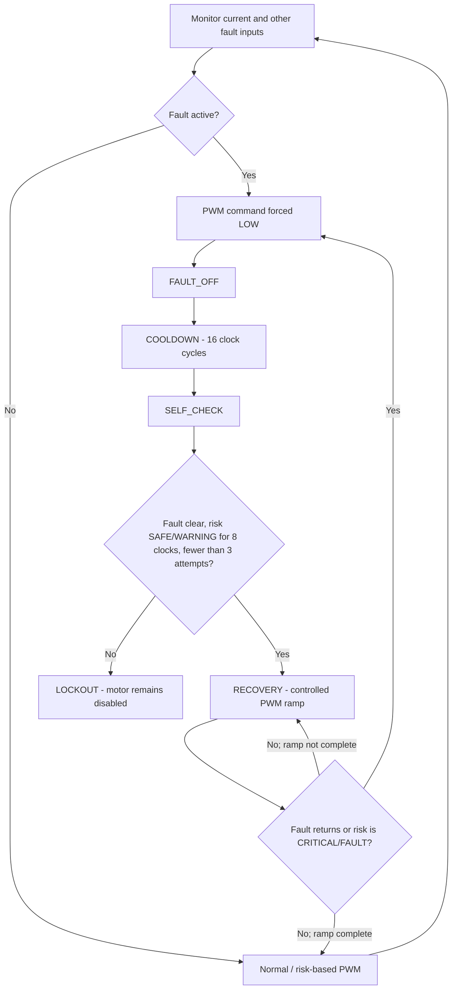
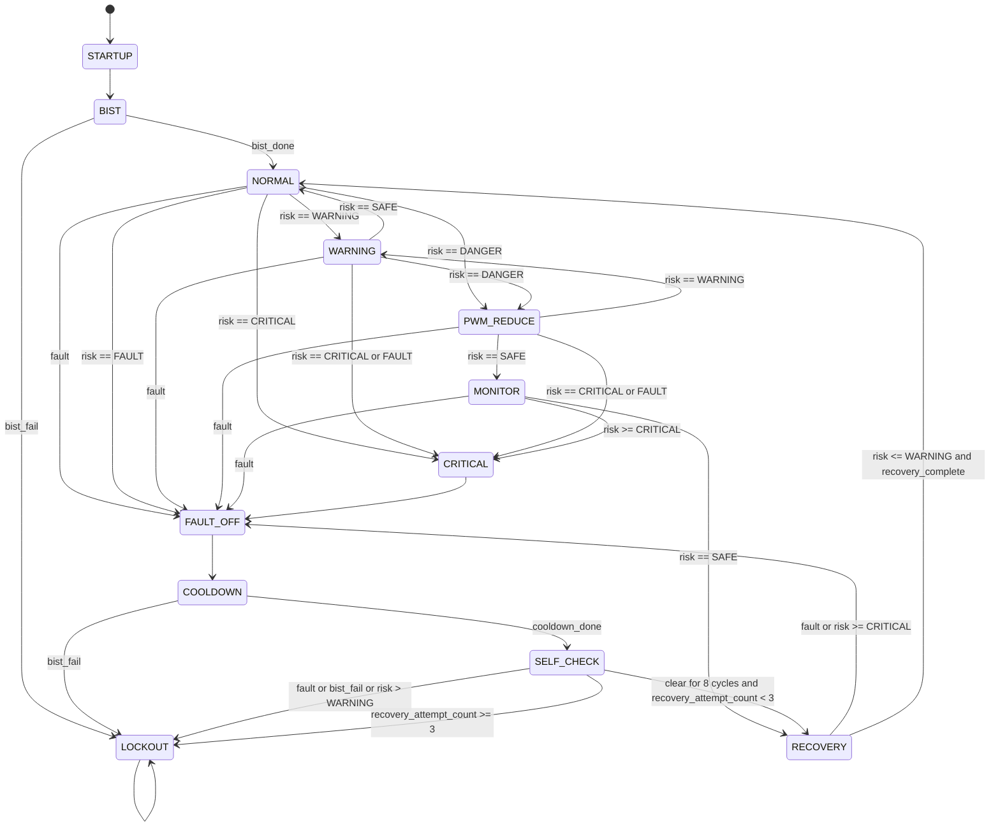
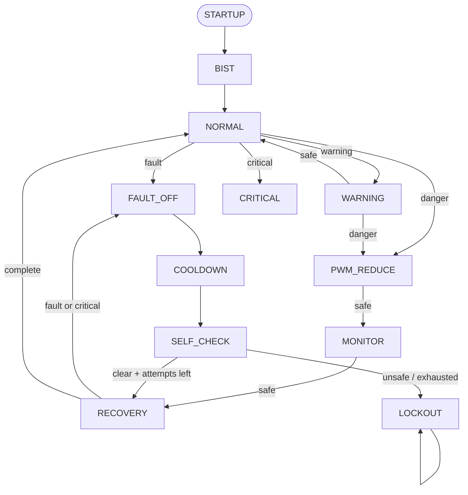
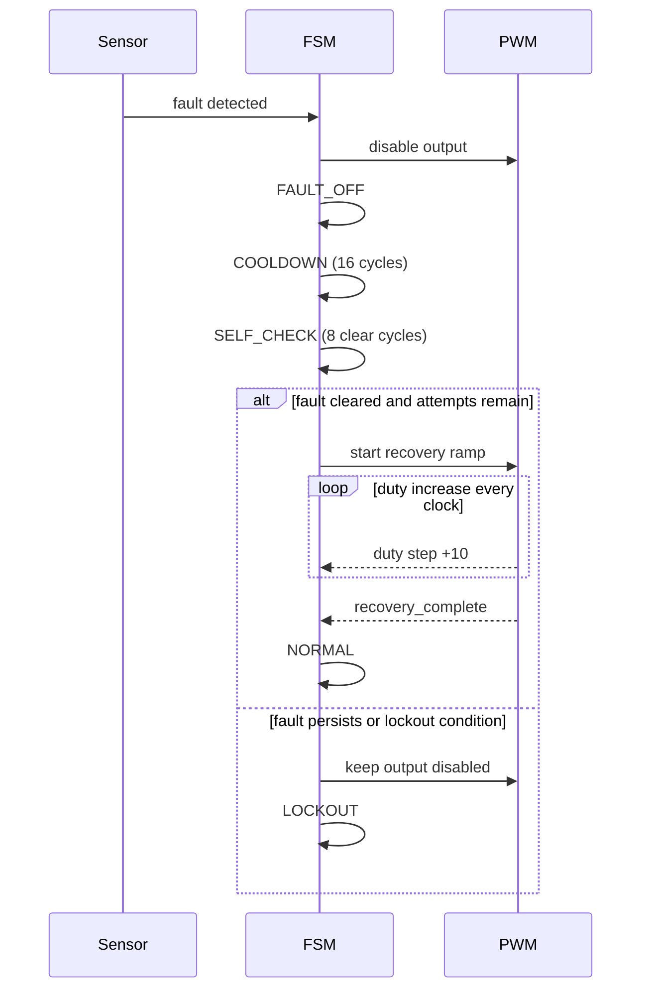

# Predictive Motor Protection System

## What this project is

This project is a simulation of a motor monitoring and protection
controller. It reads digitized current, voltage, and temperature values, looks
for risky conditions, and adjusts or disables a PWM output. It also records a
fault code and basic fault statistics.

The main idea is to respond to a problem before it becomes worse:

1. Sample sensor values.
2. Smooth the current reading and estimate its short-term trend.
3. Classify the present/predicted current risk and check other fault conditions.
4. Select a PWM duty cycle or turn the drive command off.
5. Log faults and, for eligible faults, require a stable clear period before a
   limited number of cooldown-and-recovery attempts.

This is a digital RTL model, not a complete motor-drive product. The sensor
inputs are already digital values; there is no ADC conversion interface, motor
power stage, physical-unit conversion, board pin mapping, or safety
certification in this project.

The checked-in Vivado project identifies Vivado 2023.2 and target part
`xc7a100tcsg324-1`. A device part is not a board definition: correct pin
assignments, clock definition, and electrical I/O standards still need to be
supplied for the specific board.

## Comparison with the supplied paper

The supplied reference is Zhang et al., “Three-Phase Motor Driver with
Overcurrent Protection Function,” IEEE ISCAS 2024,
[doi:10.1109/ISCAS58744.2024.10558184](https://doi.org/10.1109/ISCAS58744.2024.10558184).
This is a comparison of the paper's reported design with the RTL in this
folder, not a reproduction of the paper.

| Topic | Supplied paper | This project |
|---|---|---|
| Main goal | Design and simulate an integrated three-phase BLDC motor-driver chip | Prototype a digital FPGA-based motor monitoring and protection controller |
| Overcurrent sensing | Per-bridge current sensing using an on-chip current-mirror approach and detection logic | Compares a filtered digital current value against programmable RTL thresholds |
| Switching transients | Includes a short blanking interval in the overcurrent path to reduce false trips from switching spikes | Uses a four-sample moving average; it does not synchronize a blanking [...] |
| Drive functions | Integrates three-phase bridge/gate-drive support, charge-pump circuitry, Hall-signal decoding, PWM current control, and protection blocks | Generates one generic PWM output and a r[...] |
| Response after overcurrent | Describes turning off the driver when overcurrent is detected; the paper does not describe an automatic restart/recovery sequence | Main enhancement: after cooldown, the[...] |
| Evidence | Reports circuit-level simulations and chip-design metrics for the proposed driver | Has RTL behavioral simulation; no board-level or physical-motor validation is established here |
| Units | Paper reports physical electrical values for its design | RTL thresholds are ADC counts with no current/voltage/temperature calibration |

> ** What this project adds beyond the paper's reported protection features **
>
> The project's **main enhancement is controlled recovery after a cleared
> fault**:
>
> 1. Detect overcurrent and force the PWM command low.
> 2. Keep the motor disabled during cooldown.
> 3. Require the fault to be clear and risk no higher than WARNING for 8
>    consecutive clock cycles; a continuing fault prevents restart.
> 4. Allow at most 3 recovery attempts after reset; a further trip locks out
>    until reset.
> 5. Ramp PWM upward in 10-count steps until the current risk level's duty
>    target is reached.
> 6. Return to normal control after the ramp; if risk becomes critical or a
>    fault returns, shut down again.
>
> Supporting features include predictive current risk, sensor diagnostics,
> voltage/temperature checks, stall/persistence detection, and fault logging.
>
> **Important:** these are additional digital supervision features, not proof
> of better protection performance. The paper is a three-phase driver-chip
> design with hardware current-sensing and gate-drive circuits; this project
> is a single-PWM RTL prototype and does not implement those circuits. The
> testbench now exercises overcurrent detection, fault clearance, cooldown,
> and recovery through the top-level design; run it in Vivado to verify the
> complete sequence.
>
>

The paper and this project address related safety goals at different layers.
The paper describes a motor-driver IC and its current-sensing/gate-drive
circuits. This RTL is a higher-level digital supervisor. It should not be
described as a replacement for the paper's fast hardware overcurrent path or
as a verified three-phase driver.

### Practical enhancements inspired by the comparison

These are proposed extensions, not features already implemented:

1. **Keep a fast emergency trip.** Add a direct, low-latency overcurrent path
   that disables the drive without waiting for the four-sample filter,
   prediction, or software-style state sequencing. Keep the independent
   hardware current limit as the final safety layer.
2. **Handle switching noise deliberately.** If the current sensor produces
   switching spikes, consider a short, clock-calibrated blanking/deglitch
   window synchronized to PWM edges. Verify that it cannot mask a sustained
   overcurrent; do not copy a timing value without matching the board,
   switching frequency, sensor, and device.
3. **Extend from one current channel to three phases.** Add per-phase samples
   and checks for phase imbalance, missing phase current, and phase-specific
   overcurrent before claiming three-phase monitoring.
4. **Define an actual drive interface.** Specify how the controller safely
   disables all gate commands and how it interfaces with a real gate driver.
   The current single PWM output is not a three-phase bridge controller.
5. **Calibrate every threshold.** Document the ADC scale and derive current,
   voltage, and temperature limits from the chosen sensors and motor. The
   paper's physical values are not interchangeable with this RTL's count
   values.
6. **Complete the protection verification.** Test fast-trip latency,
   PWM-edge transients, all thresholds, phase faults, reset/lockout behavior,
   fault clearance, cooldown, and the recovery ramp. Then validate on a
   current-limited bench with independent hardware protection.

The most distinctive direction for this project is to combine a fast
independent overcurrent shutdown with the slower predictive supervision,
diagnostics, and explainable fault logging already present in the RTL.

## Design at a glance

```text
current_raw ──> ADC input register ──> 4-sample current average ──┬─> current limits
                                                                  ├─> trend/prediction
                                                                  ├─> stall/persistence checks
                                                                  └─> power/thermal checks
voltage_raw ──> ADC input register ──────────────────────────────────> voltage/power check
temperature_raw ──> ADC input register ──────────────────────────────> thermal fault check
sensor_valid_raw ──> ADC input register ────────────────────────────> diagnostics/BIST

fault checks + risk ──> fault classifier + protection state machine
                      ├─> adaptive PWM duty ──> PWM output
                      └─> fault logger
```

The top-level module is `motor_protection_top`. Its external inputs are
`clk`, active-high `reset`, three 12-bit sensor values, and
`sensor_valid_raw`. Its outputs include the PWM signal and duty, risk and fault
codes, FSM state, and diagnostic values such as filtered current, predicted
current, thermal state, and logged fault data.

At the top-level output, `pwm_out` is forced low whenever a classified `fault`
is active or the FSM has disabled the motor. This is a **logical PWM-command
shutdown**, not proof that a physical motor's power is disconnected: a real
system needs an appropriate gate-driver enable/shutdown connection and
independent hardware overcurrent protection.

### Recovery sequence at a glance

The central idea is: **trip off first, then only restart after the fault is
gone, cooldown has completed, and PWM has ramped to its target.**



During recovery, duty increases by **10 counts per clock** toward the
risk-based target (the default SAFE target is **800 counts**). If a fault
returns or risk becomes critical, the design shuts down again. It allows at
most **3 automatic recovery ramps after reset**; a further trip leads to
LOCKOUT. A fault that remains active, or risk above WARNING, during
SELF_CHECK leads to LOCKOUT; otherwise those conditions must stay clear for
8 consecutive clock cycles. This is a digital qualification interval, not a
physical safety guarantee.
This diagram shows the RTL's control behavior; `pwm_out` is a command signal,
not a physical power disconnect.

All thresholds below are **digital input counts**, unless stated otherwise.
The RTL does not define what one count means in amperes, volts, or degrees.
Those conversions and the real motor's safe limits must be established for the
actual sensors and motor before hardware use.

## Conditions and thresholds in the RTL

### Current limits and risk levels

The default thresholds in both `current_comparator` and `risk_classifier` are:

| Threshold | Default count | Meaning |
|---|---:|---|
| Warning | 1800 | Warning and above |
| Danger | 2400 | Danger and above |
| Critical | 3000 | Critical and above |
| Emergency/fault | 3600 | Emergency current fault / fault risk |

The current comparator checks the **filtered current** and asserts each output
when the value is greater than or equal to its threshold. Therefore the
warning, danger, and critical outputs are cumulative: for example, a value of
3100 also satisfies warning and danger.

The risk classifier compares both filtered current and predicted current. It
chooses the highest applicable level:

| Risk output | Encoded value | Condition |
|---|---:|---|
| SAFE | 0 | Current and prediction are below 1800 |
| WARNING | 1 | Either is at least 1800 but neither is at least 2400 |
| DANGER | 2 | Either is at least 2400 but neither is at least 3000 |
| CRITICAL | 3 | Either is at least 3000 but neither is at least 3600 |
| FAULT | 4 | Either is at least 3600 |

`risk_predictor` estimates:

```text
predicted_current = current + (current change per sample × 3)
```

The default prediction horizon is 3. Results are clamped to the range 0–4095.
The `delta_i` signal is the difference between the latest and previous
filtered-current values, in digital counts per sample (not counts per second).
`risk_classifier` has a `delta_i` input but does not use it directly; the
predictor uses it to calculate predicted current.

### Sensor diagnostics

`sensor_diagnostics` uses these defaults:

| Check | Default condition |
|---|---|
| Invalid sensor | `sensor_valid` is low; this asserts `sensor_fault` immediately |
| Invalid-sample counter | Counts up to 16 consecutive invalid samples |
| Stuck-at-zero reading | Current is exactly 0 for 16 consecutive samples |
| Stuck-at-maximum reading | Current is exactly 4095 for 16 consecutive samples |
| Implausible jump | Absolute change from the previous current sample is greater than 1500 |

The fault output is not delayed until the invalid counter reaches 16: the
`!sensor_valid` condition alone asserts it. The counter is diagnostic state and
also participates in the combined fault condition.

### Voltage and power

`voltage_power_monitor` uses a permitted voltage range of 1000 through 4000
counts, inclusive:

```text
voltage_fault = voltage < 1000 OR voltage > 4000
power_estimate = voltage × filtered_current
```

`power_estimate` is a 24-bit product of the two digital counts. It is not
calibrated watts.

### Thermal estimate and temperature

`thermal_estimator` has a default thermal fault limit of 3000 counts:

```text
thermal_fault = (thermal_state >= 3000) OR (temperature_input >= 3000)
```

Its internal estimate adds 8 counts per clock when current is greater than
1200, otherwise subtracts 2 counts per clock down to zero. It intends to
saturate at 4095.

Each clock, the candidate thermal state changes by the current-based
heating/cooling rule, then is raised to the measured temperature if that
measurement is higher. The measurement is therefore incorporated as a floor
for that update; after the measured temperature falls, the state cools
according to the current-based rule. The independent direct temperature
threshold check remains active. This is an RTL count-based model, not a
calibrated physical thermal model.

### Persistence and stall checks

| Check | Default condition |
|---|---|
| Persistent high risk | `critical_current OR danger_current` remains high for 8 clock cycles |
| Stall current | Filtered current is at least 2400 |
| Stall PWM | PWM duty is at most 300 |
| Stall trend | `delta_i <= 0` |
| Stall duration | All three stall conditions hold for 8 clock cycles |

Both detectors clear their counter and fault output when their condition stops.
The persistence detector counts danger/critical comparator outputs, not the
predicted risk level.

### Fault codes and priority

If multiple fault inputs are active at once, `fault_classifier` reports the
first matching condition in this priority order:

| Priority | Code | Fault |
|---:|---:|---|
| 1 | 1 | Sensor fault |
| 2 | 2 | Emergency current |
| 3 | 3 | Thermal fault |
| 4 | 4 | Stall |
| 5 | 5 | Voltage fault |
| 6 | 6 | Persistent overload |
| — | 0 | No fault |

The reported code identifies the highest-priority active condition; it does
not list every simultaneous fault.

### Adaptive PWM and PWM output

The adaptive duty defaults are:

| Risk | Duty count |
|---|---:|
| SAFE | 800 |
| WARNING | 650 |
| DANGER | 450 |
| CRITICAL | 200 |
| FAULT or unrecognized risk | 0 |

If the motor is not enabled, the duty is forced to 0. In recovery mode, the
controller increases duty by 10 counts per clock until it reaches the
risk-based target. It asserts `recovery_complete` when the actual duty has
reached that target. Outside recovery, it selects the target duty immediately.

The PWM counter wraps every 1024 clock cycles. The output is high while
`counter < duty`; therefore duty is expressed in counter counts (for example,
800 is approximately 78.1% of the 1024-count period).

## Protection state machine

State values are also exposed on the top-level `fsm_state` output.

| State value | State | Implemented behavior |
|---:|---|---|
| 0 | STARTUP | Advances to BIST |
| 1 | BIST | Waits for BIST completion; BIST failure sends the FSM to lockout |
| 2 | NORMAL | Fault shuts down; otherwise follows warning/danger/critical risk |
| 3 | WARNING | Motor remains enabled; returns toward normal as risk falls |
| 4 | PWM_REDUCE | Motor remains enabled at reduced risk-based PWM |
| 5 | MONITOR | Motor remains enabled while checking for recovery or worsening risk |
| 6 | CRITICAL | Advances to fault-off |
| 7 | FAULT_OFF | Motor disabled, then advances to cooldown |
| 8 | COOLDOWN | Waits for 16 clock cycles, unless BIST failure causes lockout |
| 9 | SELF_CHECK | Fault, BIST failure, or risk above WARNING causes lockout; otherwise requires 8 consecutive clear cycles and an available recovery attempt |
| 10 | RECOVERY | Motor enabled; stays here until the recovery PWM reaches its target |
| 11 | LOCKOUT | Motor disabled; remains locked until reset |

Risk transitions in the normal operating states:

- NORMAL: fault -> FAULT_OFF; WARNING -> WARNING; DANGER -> PWM_REDUCE;
  CRITICAL -> CRITICAL; FAULT risk -> FAULT_OFF.
- WARNING: fault -> FAULT_OFF; SAFE -> NORMAL; DANGER -> PWM_REDUCE;
  CRITICAL or FAULT risk -> CRITICAL.
- PWM_REDUCE: fault -> FAULT_OFF; SAFE -> MONITOR; WARNING -> WARNING;
  CRITICAL or FAULT risk -> CRITICAL.
- MONITOR: fault -> FAULT_OFF; SAFE -> RECOVERY; CRITICAL or FAULT risk ->
  CRITICAL. WARNING and DANGER leave it in MONITOR.
- RECOVERY: fault or CRITICAL/FAULT risk -> FAULT_OFF; SAFE/WARNING returns
  to NORMAL only after `recovery_complete` is asserted by the adaptive PWM.

This keeps the FSM in RECOVERY for the whole upward PWM ramp. With SAFE risk,
the default target is 800, and a ramp from 0 takes 80 clock cycles at 10 counts
per cycle. With WARNING risk, the target is 650 and the ramp takes 65 cycles.
If risk worsens to CRITICAL or FAULT during recovery, the FSM goes back to
FAULT_OFF instead of continuing the ramp.

The default cooldown is 16 clock cycles. Its duration in seconds depends on
the clock frequency. LOCKOUT is sticky and requires reset to leave it.

### FSM state diagram



### Simplified FSM overview



### Recovery timing view



### FSM state encoding table

| State value | State name | RTL constant |
|---:|---|---|
| 0 | STARTUP | `ST_STARTUP` |
| 1 | BIST | `ST_BIST` |
| 2 | NORMAL | `ST_NORMAL` |
| 3 | WARNING | `ST_WARNING` |
| 4 | PWM_REDUCE | `ST_PWM_REDUCE` |
| 5 | MONITOR | `ST_MONITOR` |
| 6 | CRITICAL | `ST_CRITICAL` |
| 7 | FAULT_OFF | `ST_FAULT_OFF` |
| 8 | COOLDOWN | `ST_COOLDOWN` |
| 9 | SELF_CHECK | `ST_SELF_CHECK` |
| 10 | RECOVERY | `ST_RECOVERY` |
| 11 | LOCKOUT | `ST_LOCKOUT` |

### Built-in self-test (BIST)

The BIST controller defaults to 4 cycles. It checks `sensor_valid` during its
active window (after the first count), records a failure if it sees an invalid
sample, and marks itself done after the configured count. The FSM prioritizes
BIST failure over completion.

Despite its name, this BIST only checks the sensor-valid input. It does not
test the internal datapath, memory, PWM output, or physical motor hardware.

### Fault logging

`fault_logger` records:

- `last_fault_code`: updated while a fault is active.
- `peak_current`: highest filtered current since reset.
- `fault_duration`: consecutive clock cycles with any fault, saturating at
  65535 and clearing when no fault is active.

The peak is not cleared when an individual fault ends; it is cleared by reset.

## Simulation

The Vivado project is configured to use `tb_motor_protection_top` as the
simulation top. In the Vivado Tcl Console, refresh the simulation source order
and run:

```tcl
update_compile_order -fileset sim_1
launch_simulation -simset sim_1 -mode behavioral
run all
```

If a simulation is already open, close it first with `close_sim`. A successful
run ends with `PASS: all motor protection testbench scenarios completed`.

The self-checking testbench currently checks:

1. Successful startup/BIST and safe PWM duty of 800.
2. A stepped current input reaching the emergency-current threshold and fault
   logging code 2; it also checks that PWM goes low immediately on fault and
   stays low while overcurrent remains active, reaching lockout.
3. Top-level recovery after overcurrent clears, including the clear
   qualification interval, cooldown, intermediate PWM duty, and return to
   NORMAL at safe duty 800.
4. Three recovery attempts are allowed after reset; a subsequent cleared trip
   reaches LOCKOUT with PWM disabled.
5. Invalid sensor input causing sensor fault code 1, shutdown, and lockout.
6. Invalid sensor input during startup causing BIST failure and lockout.

It prints `PASS: all motor protection testbench scenarios completed` when those
checks pass. The recovery and attempt-limit tests use the complete top-level
sensor-to-fault path. The bench still does not test voltage limits, thermal
thresholds, persistence timing, stall timing, PWM waveform period, or
simultaneous-fault priority.

The user-reported Vivado behavioral simulation completed all six scenarios
and printed `PASS: all motor protection testbench scenarios completed`,
including the clear-qualification and recovery-attempt-limit tests. This is
RTL simulation evidence only, not hardware validation or evidence for the
untested behaviors above.

The user-reported Vivado RTL synthesis completed with **0 errors** and **0
critical warnings**. The subsequent implementation report says placement and
routing completed successfully, with **343 LUTs (0.54%)** and **285 flip-flops
(0.22%)** used on the selected `xc7a100tcsg324-1` device. The routed timing
summary reports WNS/TNS as **NA** because the design has **no user-specified
timing constraints**; timing closure has therefore not been demonstrated.
Vivado also warns that power estimation is inaccurate without a defined clock.

The user subsequently reran the behavioral simulation, which printed
`PASS: all motor protection testbench scenarios completed`; this run includes
the thermal-state check that verifies a 500-count temperature reaches
`thermal_state`. Synthesis has not yet been rerun after the thermal-state fix,
so the resource and warning details below are from the prior source version.

That earlier synthesis reported 16 warnings. Some report unused temporary registers
(`prediction_temp` and `abs_jump`) that synthesis optimized away; the unused
`delta_i` input on `risk_classifier` is redundant because the classifier uses
`predicted_current`. The earlier synthesis report also identified the
thermal-state update gap, which has since been fixed and simulation-tested.
Successful synthesis, placement, and routing do not establish timing closure
or hardware operation.

## File guide

| File | Purpose |
|---|---|
| `motor_protection_top.v` | Connects all blocks and defines project inputs/outputs |
| `adc_interface.v` | Registers incoming digital sensor values; not an ADC driver |
| `current_filter.v` | Four-sample moving average of current |
| `current_comparator.v` | Current warning, danger, critical, and emergency flags |
| `trend_detector.v` | Difference between consecutive filtered-current samples |
| `risk_predictor.v` | Projects current three samples ahead |
| `risk_classifier.v` | Selects risk level from current and predicted current |
| `voltage_power_monitor.v` | Voltage-range fault and raw-count power product |
| `thermal_estimator.v` | Current-based thermal state and temperature fault |
| `persistence_detector.v` | Detects sustained danger/critical current |
| `stall_detector.v` | Detects high current with low PWM and non-rising current |
| `sensor_diagnostics.v` | Invalid, stuck-at, and sudden-jump checks |
| `bist_controller.v` | Startup sensor-valid check |
| `fault_classifier.v` | Chooses fault output and prioritized code |
| `protection_fsm.v` | Startup, operating, shutdown, cooldown, recovery, and lockout states |
| `adaptive_pwm.v` | Chooses risk-based duty and recovery increments |
| `pwm_generator.v` | Converts duty count to the PWM waveform |
| `fault_logger.v` | Stores last fault code, peak current, and fault duration |
| `tb_motor_protection_top.v` | Self-checking behavioral simulation scenarios |
| `Project_simulation_1.xpr` | Vivado project configuration |


## Important engineering gaps before hardware use

1. Convert ADC counts to physical units and set thresholds from the actual
   motor, sensors, and operating conditions.
2. Fix and test the thermal-state temperature integration gap described above.
3. Add a full top-level test that clears a measured overcurrent and verifies
   the sensor-to-FSM cooldown/recovery path.
4. Add tests for all thresholds, fault-code priority, PWM timing, and boundary
   cases, including simultaneous faults.
5. Add and verify the correct FPGA pin constraints, clock constraints, and
   board-specific I/O settings for the target hardware.
6. Validate protection behavior on a safe bench setup before connecting a
   motor. This prototype is not a substitute for independent hardware
   overcurrent protection or a certified safety system.
